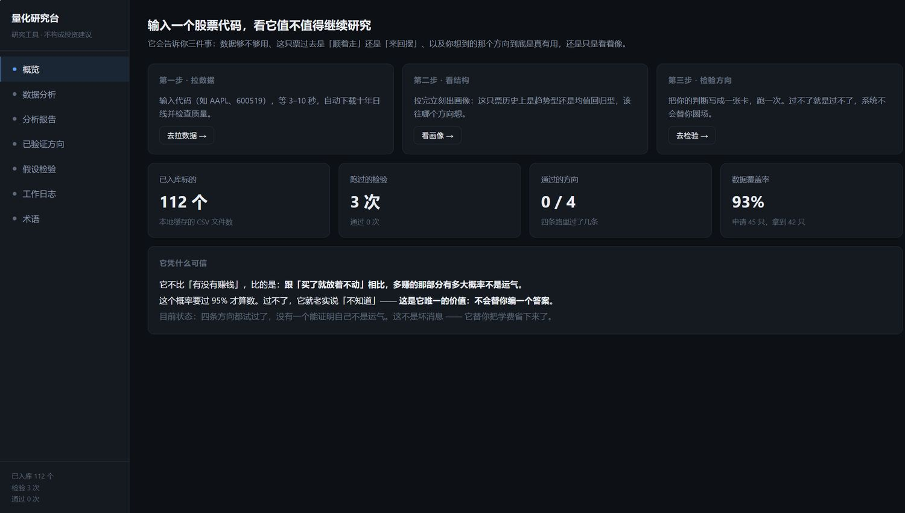
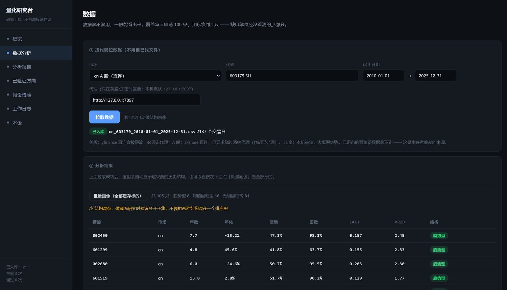
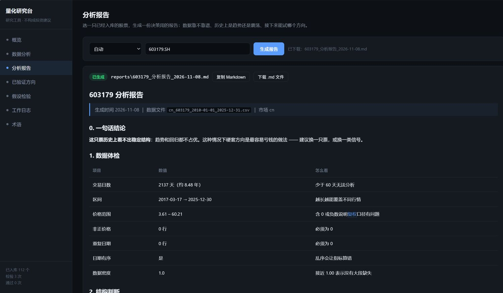

[](https://github.com/xulin095/quant-research-console/actions/workflows/ci.yml)
[](LICENSE)
[](https://www.python.org/)

# Quant Research Console

**English** | [简体中文](README.zh-CN.md)

> **Should I keep researching this stock?** This tool answers with rules, not gut feeling.
>
> It will not tell you what to buy. It tells you three things: whether the data is good enough
> to trust, whether the stock has historically *trended* or *mean-reverted*, and whether the
> idea you have is real — **or just noise that happens to look like a pattern.**

> ⚠️ **Research instrument.** Not investment advice. No price predictions. No promised returns.

---

## Screenshots

| Overview: three steps, one research cycle | Data: fetch by ticker, inspect structure |
| --- | --- |
|  |  |

**Analysis report**: pick a ticker, get a report covering data health, structural verdict,
directions worth testing, and known risks. Downloadable as Markdown.



*UI screenshots are in Chinese; an English UI is on the roadmap — see [Where I need help](#where-i-need-help).*

---

## The problem it solves

Most "quant" projects fail for the same reasons, and none of them are bugs in the code:

- A backtest returns +5%, while simply buying and holding the same stock returned +48%.
  The strategy is **negative** — it just doesn't look like it.
- Momentum "works" on the 12 famous stocks you picked. Widen the universe to 59 stocks
  including the losers, and the effect **disappears**. That was survivorship bias.
- You tried 12 parameter sets and kept the best one. That is not a discovery, it is a search.

This project turns those traps into **mechanical checks**. Every claim either passes or fails.
There is no "mostly passes".

## What this does, and what it does not

**It does:**

- Check whether a price series is usable at all: non-positive prices, duplicate dates, gaps.
  118 of 118 cached files pass this gate.
- Describe what a stock did over a given stretch of history -- trending, mean-reverting, or
  neither -- and show the evidence strength behind that description.
- Test a hypothesis mechanically: does the excess return over buy-and-hold have a 95% confidence
  interval whose lower bound is above zero, on out-of-sample data?
- Recompute its own output with a separate implementation and tell you when the two disagree.
- Keep an append-only log, failures included, so "how many times did I try" is never hidden.

**It does not:**

- Predict prices. There is no forecast anywhere in this repository.
- Promise that a described structure will continue. Measured: of 25 tickers showing a structure in
  the first 70% of their history, **2 (8%)** kept it in the last 30%.
- Tell you what to buy, how much, or when.
- Produce "95% accuracy". Anything advertising that is selling something.

**Measured, not asserted** (see [docs/evaluation.md](docs/evaluation.md)):

| Question | Result |
| --- | --- |
| Data integrity across 118 cached files | 100% |
| Same data profiled twice | identical numbers |
| Generated reports confirmed by an independent recomputation | 6 / 6 |
| A single-name structure persisting out of sample | **8%** (2 of 25) |
| The same, after adding an in-sample persistence filter | **0%** (0 of 14) -- reverted |

**Three honest ways to use it:**

1. **Before believing an idea, check the data.** Most "the data says X" claims die at the hygiene
   gate: negative prices from forward adjustment, duplicate rows, gaps.
2. **Kill a bad idea cheaply.** Write the card, run the audit, accept the verdict. A failed card
   costs an hour; a failed position costs money.
3. **Keep the log.** Six months from now "I already tried that, here is the card" is worth more
   than a folder of charts.

**One dishonest way:** treating the structural verdict as a trading signal. It describes one
stretch of history, not the next one.

## How a verdict is decided

| What it compares | Not "did it make money", but **how much it beat buy-and-hold** |
| --- | --- |
| The bar | The 95% confidence interval of excess return must have a **lower bound > 0**, on **out-of-sample** data |
| If it fails | It is recorded as a failure, the parameters are **frozen**, and you may not tweak and retry |

## Quick start

```bash
python -m venv .venv
.venv\Scripts\activate            # Windows
# source .venv/bin/activate       # macOS / Linux
pip install -r requirements.txt

python -m app.server --open       # opens http://127.0.0.1:8765
```

Windows users can also double-click `启动研究台.bat` (it resolves its own directory).

**No network? You can still test it.** `samples/` contains three synthetic series
(trending / mean-reverting / random walk) and two deliberately broken files
(missing volume column, negative prices). Drag them into the upload panel and the whole
pipeline runs — which is exactly how you can check whether it fails *loudly* or
**quietly computes the wrong thing**.

Everything also works headless:

```bash
python -m tools.fetch_basket --market cn --symbols 600519 --start 2015-01-01 --end 2025-12-31
python -m tools.profile --symbol 600519          # structural profile
python -m tools.stock_report --symbol 600519     # decision report
python -m tools.audit cards/HK-001.json          # run one hypothesis test
```

## One research cycle

```
1. Fetch      Enter a ticker (AAPL / 600519 / 002541.SZ). Ten years of daily bars, quality-checked.
2. Profile    Trending / mean-reverting / no structure — autocorrelation + variance ratio + permutation test.
3. Hypothesize  Write the idea as a card (direction, lookback, how many names). Parameters freeze on run.
4. Audit      Test it on data after 2021 only, and compute how likely the result is luck.
5. Report     Data health / structural verdict / directions worth testing / risks / disclaimer. Downloadable.
6. Log        Every run is recorded, failures included — because "how many times did you try" drives significance.
```

## Layout

```
app/            Local web console (stdlib HTTP server, zero frontend build step)
├─ server.py    API: fetch / profile / report / run card / glossary
└─ static/      Single-page UI (inline CSS/JS)

tools/          Research tooling (each runs standalone on the CLI)
├─ validate.py       Time-series: walk-forward + deflated Sharpe + block-bootstrap CI
├─ cross_section.py  Cross-section: rank IC + confidence interval + cost-aware backtest
├─ cs_audit.py       Triple audit: lookback neighbourhood / Bonferroni / holdout
├─ decide.py         Decision layer: rule-table replay
├─ profile.py        Single-ticker structural profile (autocorr / variance ratio / permutation)
├─ profile_all.py    Batch profiling
├─ stock_report.py   Per-ticker analysis report
├─ universe.py       Honest universe: delisted sampling + coverage measurement
├─ audit.py          Single entry point: card → verdict → append-only log
└─ fetch_basket.py   Batch fetch

data/           Pluggable source adapters (registry in data/registry.py)
referee/        Independent referees (deliberately do NOT import project code)
cards/          Hypothesis cards (one per idea, parameters frozen)
tests/          132 tests
```

## What has actually been tested (honest edition)

Four approaches, **none of them passed**:

| Approach | Sample | Result |
| --- | --- | --- |
| Time-series MA crossover timing | 15 tickers | No excess-return evidence; 11 significantly *underperformed* buy-and-hold |
| Decision rule layer | 10 tickers | 0 passed; average position 0.0–0.3% — it barely traded |
| Cross-sectional momentum | 59 US tickers | 0 of 12 lookbacks significant (IC=+0.063 on 12 famous names; vanished when widened) |
| Cross-sectional reversal (pre-registered HK-001) | 42 A-shares incl. 11 delisted | Failed; discovery-adjusted p=0.987 |

**This is not a failure. It is the product working. It saved you the tuition.**

## How to verify it is not lying to you

```bash
# Independent recompute: does NOT import project code, re-derives everything from the CSV,
# then reconciles the numbers against the generated report.
python referee/profile_check.py \
  --csv data_cache/cn_600519_2020-01-01_2025-12-31.csv \
  --report reports/600519_分析报告_2026-11-08.md
```

Exit code 0 means the report matches an independent recomputation; 1 means it does not.
It was validated against a **deliberately tampered report**, and it did flag the mismatch.

## Known limitations

- **Daily bars only**, one ticker per CSV. No intraday, no order book.
- **Delisted tickers are mostly unavailable for free**: 0 of 14 delisted US tickers were retrievable,
  roughly 70% of delisted A-shares were. Survivorship bias cannot be fully removed with free data.
- **A-shares need back-adjusted prices** (`hfq`) for long history. Forward adjustment (`qfq`)
  can produce *negative* prices on high-dividend names — this project hit that bug.
- No modelling of limit-up / limit-down, trading halts, or T+1 constraints on fills.
  Costs are estimated at 0.08% per side.
- The structural verdict depends on a permutation test, so its z-score moves slightly with the
  random seed. The guarantee is **verdict-level agreement**, not decimal agreement.
- **The UI is Chinese-only** (see below).

## Tests

```bash
python -m unittest discover -s tests -v     # 132 cases
```

The suite needs **only pandas and numpy**: `yfinance`, `akshare` and `requests` are imported
lazily inside functions, so you can run the tests without any data-source package installed
(enforced by `tests/test_import_hygiene.py`).

Covered: market/ticker compatibility (an A-share code must not be fetched as a US ticker),
ticker normalisation (`002541.SZ` → `002541`), report section completeness and banned phrases,
dirty-data detection, "a random walk must not be classified as a trend", frontend JS syntax,
and no hard-coded personal paths anywhere in the repo.

## Where I need help

What this project lacks is not code, it is **outside eyes**. In order of value:

1. **Run it on a different market.** Every conclusion so far comes from A-share and US daily bars.
   Hong Kong, futures, ETFs are entirely untested.
2. **Feed it dirty data.** Missing days, split discontinuities, wrong volume units, unsorted dates —
   I want to know the cases where it **fails silently**.
3. **Falsify my conclusions.** `ROADMAP-v2.md` explains why four approaches failed.
   If you think one of them actually has an edge, write a card and run it — don't just say so.
4. **English UI.** The interface is Chinese-only. This is pure grunt work and very welcome.

## Contributing

See [CONTRIBUTING.md](CONTRIBUTING.md) — how to run the tests, what to include in a bug report,
and **which changes I will reject** (for example, lowering the significance threshold).

## Disclaimer

This tool is a research instrument. It outputs historical descriptions and the results of
statistical significance tests. It does not constitute investment advice, does not predict prices,
and does not promise returns.

It describes the past, not the future. Do not trade real money off it.